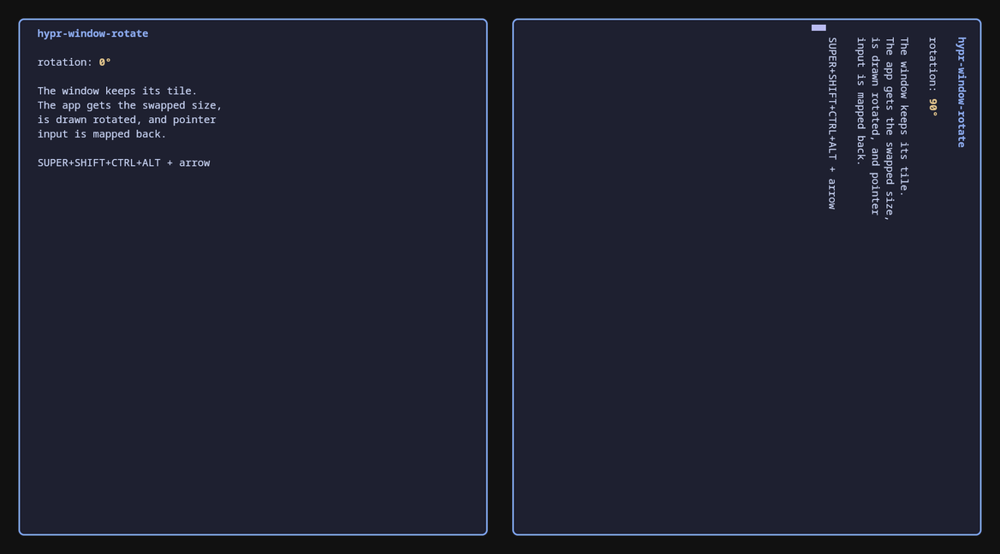

# hypr-window-rotate

A [Hyprland](https://hypr.land) plugin that rotates individual windows in 90° steps.

I made this plugin because of a small, recurring annoyance. In a video call, someone turns their camera mid-call and the app doesn't rotate the stream, so they stay sideways on my screen. Or a friend sends me a sideways photo: "look at this". I don't want to tilt my head or open the picture in an editor for a few seconds of looking, so instead I press a shortcut and turn the window for a moment.



Hyprland can only rotate a whole monitor. This plugin rotates a single window:

- The window keeps its tile, so the layout, borders, shadows, rounding and blur stay as they are.
- At 90° and 270° the application is configured with the swapped size, so a portrait tile gets landscape content and the other way around. The content fills the tile and is not scaled.
- Pointer input is mapped back, so you can click, select and scroll in a rotated window as usual.
- Works with Wayland and XWayland clients, on normal and rotated monitors.

## Versioning

The plugin version is the Hyprland version it is built for, followed by `+` and a release counter that starts at 1 for every Hyprland version. `0.57.0+1` is the first release for Hyprland 0.57.0, a fix for the same Hyprland would be `0.57.0+2`, and the first release for Hyprland 0.57.1 would be `0.57.1+1`.

The older `0.1.0` release is the one for Hyprland 0.56.2.

## Compatibility

Hyprland plugins are locked to the exact Hyprland build they were compiled against. Hyprland refuses to load a mismatched plugin. Rebuild the plugin after every Hyprland update, and the packages below do this for you.

| Distribution | Hyprland | Plugin release | Status |
| --- | --- | --- | --- |
| Fedora 44 (copr `lionheartp/Hyprland`) | 0.57.0 | 0.57.0+1 | Tested at runtime, RPM builds |
| Arch Linux (`extra`) | 0.57.0 | 0.57.0+1 | Package builds and installs, all hook targets present |
| Debian sid | 0.57.0 | 0.57.0+1 | Package builds and installs, all hook targets present |
| Debian forky | 0.56.2 | 0.1.0 | See the [0.1.0 release](https://github.com/dox187/hypr-window-rotate/releases/tag/v0.1.0) |
| Ubuntu 26.10 | 0.56.2 | 0.1.0 | See the [0.1.0 release](https://github.com/dox187/hypr-window-rotate/releases/tag/v0.1.0) |
| Debian 13 trixie (backports) | 0.55.2 | none | Not supported: older Hyprland internals |
| Ubuntu 26.04 LTS | 0.53.3 | none | Not supported: older Hyprland internals, no Lua config |

The plugin hooks some Hyprland internals, so a new Hyprland release usually needs a plugin update. `make check` tells you whether your Hyprland build still exports every function the plugin hooks. CI builds the plugin and runs this check weekly on Arch Linux, Debian sid and the newest Ubuntu: it skips a distribution whose Hyprland is older than the one the plugin targets, and fails when a distribution has moved to a newer Hyprland.

## Installation

### Prebuilt packages

The [latest release](https://github.com/dox187/hypr-window-rotate/releases/latest) has packages for Fedora 44 (copr `lionheartp/Hyprland`), Arch Linux and Debian sid. Each package fits only the exact `hyprland` package listed in the release notes, and the package manager will refuse it otherwise. If your Hyprland is different, build the package yourself as shown below.

```sh
sudo dnf install ./hypr-window-rotate-0.57.0+1-1.fc44.x86_64.rpm         # Fedora
sudo pacman -U hypr-window-rotate-0.57.0+1-1-x86_64.pkg.tar.zst          # Arch
sudo apt install ./hypr-window-rotate_0.57.0+1_debian-sid_amd64.deb      # Debian sid
```

### Arch Linux

```sh
git clone https://github.com/dox187/hypr-window-rotate
cd hypr-window-rotate/packaging/arch
makepkg -si
```

The plugin is installed to `/usr/lib/hyprland/plugins/hypr-window-rotate.so`. The package depends on the exact `hyprland` version it was built against.

### Fedora (RPM)

The spec requires `hyprland-devel` matching your installed `hyprland`. With the copr `lionheartp/Hyprland` repository both come from the same repo.

```sh
sudo dnf install rpm-build gcc-c++ make hyprland-devel lua-devel
git clone https://github.com/dox187/hypr-window-rotate
cd hypr-window-rotate
mkdir -p ~/rpmbuild/SOURCES
curl -L -o ~/rpmbuild/SOURCES/hypr-window-rotate-0.57.0+1.tar.gz \
    https://github.com/dox187/hypr-window-rotate/archive/v0.57.0+1/hypr-window-rotate-0.57.0+1.tar.gz
rpmbuild -bb packaging/rpm/hypr-window-rotate.spec
sudo dnf install ~/rpmbuild/RPMS/x86_64/hypr-window-rotate-0.57.0+1-1.*.rpm
```

The plugin is installed to `/usr/lib64/hyprland/hypr-window-rotate.so`.

### Debian / Ubuntu (deb)

This works on Debian sid, which ships Hyprland 0.57.0 (`hyprland-dev`). For Hyprland 0.56.2 (Debian forky, Ubuntu 26.10) check out the `v0.1.0` tag first.

```sh
sudo apt install build-essential debhelper hyprland-dev liblua5.4-dev libpixman-1-dev libdrm-dev pkgconf
git clone https://github.com/dox187/hypr-window-rotate
cd hypr-window-rotate
dpkg-buildpackage -b -us -uc
sudo apt install ../hypr-window-rotate_0.57.0+1_*.deb
```

The plugin is installed to `/usr/lib/hyprland/plugins/hypr-window-rotate.so`.

### hyprpm

```sh
hyprpm add https://github.com/dox187/hypr-window-rotate
hyprpm enable hypr-window-rotate
```

The repository contains a `hyprpm.toml`, but this route has not been tested yet.

### Manual

Requires the Hyprland development headers (`pkg-config --cflags hyprland` must work), a C++26 compiler and the Lua 5.4 headers.

```sh
make
make install PREFIX=~/.local    # ~/.local/lib/hyprland/plugins/hypr-window-rotate.so
```

`make install` writes a new file instead of overwriting in place, so it is safe while Hyprland has the old copy loaded. Run `hyprctl reload` afterwards.

## Configuration

Hyprland 0.57 only reads Lua configs (`hyprland.lua`), so the plugin is driven from Lua as well.

```lua
hl.plugin.load("/usr/lib/hyprland/plugins/hypr-window-rotate.so")

-- SUPER + SHIFT + CTRL + ALT + arrow: the arrow is where the window's top edge points
local mods = "SUPER + SHIFT + CTRL + ALT"
hl.bind(mods .. " + up",    function() hl.plugin.window_rotate.rotate(0) end)
hl.bind(mods .. " + right", function() hl.plugin.window_rotate.rotate(90) end)
hl.bind(mods .. " + down",  function() hl.plugin.window_rotate.rotate(180) end)
hl.bind(mods .. " + left",  function() hl.plugin.window_rotate.rotate(270) end)
```

From a shell: `hyprctl eval "hl.plugin.window_rotate.rotate(90)"`.

The `window_rotate` dispatcher of the 0.1.0 release for `hyprland.conf` is gone: Hyprland 0.57 removed hyprlang configs and plugin dispatchers.

On Fedora the plugin path is `/usr/lib64/hyprland/hypr-window-rotate.so`.

### Arguments

Every command acts on the active window.

| Argument | Effect |
| --- | --- |
| `0`, `90`, `180`, `270` (any multiple of 90, also negative) | Set the absolute clockwise angle |
| `cw` (default) / `ccw` | Turn by 90° clockwise / counter-clockwise |
| `flip` | Turn by 180° |
| `reset` | Back to 0° |

## How it works

The plugin hooks eight Hyprland functions. Hyprland already has the pieces needed to draw a buffer rotated (`wl_surface.set_buffer_transform`); the plugin uses them for whole windows:

- **Size:** `CWindowTarget::sendWindowSize` configures the client with the swapped size for 90° and 270°.
- **Rendering:** `CSurfacePassElement::getTexBox` rotates the placement of the main surface and its subsurfaces around the window center. `IElementRenderer::drawSurface` adds the rotation to the surface's buffer transform while the surface is drawn. `IElementRenderer::calculateUVForSurface` fits the UVs in the unrotated frame.
- **Input:** `CViewHitTester::windowSurfaceAt` looks up the surface under the unrotated point. `CSeatManager::setPointerFocus` and `CSeatManager::sendPointerMotion` rotate the coordinates sent to the client.
- **Damage:** `IHyprRenderer::damageSurface` repaints the whole window, because partial damage would land on the wrong spot once rotated.

When no window is rotated, every hook returns straight to the original function.

## Limitations

- Popups (context menus, tooltips, dropdowns) are not rotated. They appear upright, positioned relative to the unrotated application.
- Only the pointer is remapped. Touch and tablet input are not.
- A rotated window is repainted as a whole on every update.
- The rotation is not persistent: it is gone when the window closes or Hyprland restarts.

## Changelog

### 0.57.0+1 (2026-11-02), for Hyprland 0.57.0

- Ported to Hyprland 0.57.0. This release does not load into Hyprland 0.56.x, and 0.1.0 does not load into 0.57.0.
- New version scheme: the Hyprland version the plugin is built for, plus `+` and a release counter that starts at 1 for every Hyprland version.
- Removed the `window_rotate` dispatcher and the `hyprland.conf` example, because Hyprland 0.57 removed hyprlang configs and plugin dispatchers. The Lua function `hl.plugin.window_rotate.rotate` is unchanged.
- The size swap hooks `CWindowTarget::sendWindowSize`, because Hyprland 0.57 moved window configuration into window backends and removed `CWindow::realToReportSize`.
- Rotation is composed with the inverse of the surface's buffer transform, which is how Hyprland 0.57 draws it, so windows still turn in the stated direction.
- CI builds only where the distribution ships the targeted Hyprland version. It skips older ones and fails when a distribution moves to a newer Hyprland.

### 0.1.0 (2026-10-28), for Hyprland 0.56.2

- First release: rotate individual windows in 90° steps. The window keeps its tile, the application gets the swapped size at 90° and 270°, is drawn rotated, and pointer input is mapped back.
- Lua config: `hl.plugin.window_rotate.rotate(90)`. hyprlang config: `window_rotate, 90` dispatcher.
- Packaging for Fedora (RPM spec), Arch Linux (PKGBUILD) and Debian/Ubuntu (`debian/`), plus `hyprpm.toml`.

## License

[BSD-3-Clause](LICENSE), the same as Hyprland.
