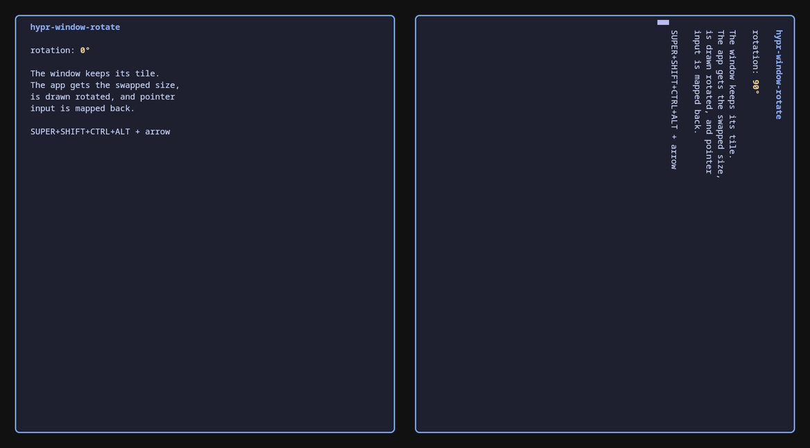

# hypr-window-rotate

A [Hyprland](https://hypr.land) plugin that rotates individual windows in 90° steps.



Hyprland can only rotate a whole monitor. This plugin rotates a single window:

- The window keeps its tile, so the layout, borders, shadows, rounding and blur stay as they are.
- At 90° and 270° the application is configured with the swapped size, so a portrait tile gets landscape content and the other way around. The content fills the tile and is not scaled.
- Pointer input is mapped back, so you can click, select and scroll in a rotated window as usual.
- Works with Wayland and XWayland clients, on normal and rotated monitors, and with both Lua (`hyprland.lua`) and hyprlang (`hyprland.conf`) configs.

## Compatibility

Hyprland plugins are locked to the exact Hyprland build they were compiled against. Hyprland refuses to load a mismatched plugin. Rebuild the plugin after every Hyprland update, and the packages below do this for you.

| Distribution | Hyprland | Status |
| --- | --- | --- |
| Fedora 44 (copr `lionheartp/Hyprland`) | 0.56.2 | Tested at runtime, RPM builds |
| Arch Linux (`extra`) | 0.56.2 | Package builds and installs, all hook targets present |
| Debian sid / forky | 0.56.2 | Package builds and installs, all hook targets present |
| Ubuntu 26.10 | 0.56.2 | Package builds and installs, all hook targets present |
| Debian 13 trixie (backports) | 0.55.2 | Not supported yet: older Hyprland internals |
| Ubuntu 26.04 LTS | 0.53.3 | Not supported yet: older Hyprland internals, no Lua config |

The plugin hooks some Hyprland internals, so a new Hyprland release may need a plugin update. `make check` tells you whether your Hyprland build still exports every function the plugin hooks. CI runs a build and this check weekly against Arch Linux, Debian sid and the newest Ubuntu.

## Installation

### Prebuilt packages

The [latest release](https://github.com/dox187/hypr-window-rotate/releases/latest) has packages for Fedora 44 (copr `lionheartp/Hyprland`), Arch Linux, Debian sid/forky and Ubuntu 26.10. Each package fits only the exact `hyprland` package listed in the release notes, and the package manager will refuse it otherwise. If your Hyprland is different, build the package yourself as shown below.

```sh
sudo dnf install ./hypr-window-rotate-0.1.0-1.fc44.x86_64.rpm            # Fedora
sudo pacman -U hypr-window-rotate-0.1.0-1-x86_64.pkg.tar.zst             # Arch
sudo apt install ./hypr-window-rotate_0.1.0_ubuntu-26.10_amd64.deb       # Ubuntu (or the debian-sid file)
```

### Arch Linux

```sh
git clone https://github.com/dox187/hypr-window-rotate
cd hypr-window-rotate/packaging/arch
makepkg -si
```

The plugin is installed to `/usr/lib/hyprland/plugins/hypr-window-rotate.so`. The package depends on the exact `hyprland` version it was built against.

### Fedora (RPM)

The spec requires `hyprland-devel` matching your installed `hyprland`. With the copr `lionheartp/Hyprland` repository both come from the same repo.

```sh
sudo dnf install rpm-build gcc-c++ make hyprland-devel lua-devel
git clone https://github.com/dox187/hypr-window-rotate
cd hypr-window-rotate
mkdir -p ~/rpmbuild/SOURCES
curl -L -o ~/rpmbuild/SOURCES/hypr-window-rotate-0.1.0.tar.gz \
    https://github.com/dox187/hypr-window-rotate/archive/v0.1.0/hypr-window-rotate-0.1.0.tar.gz
rpmbuild -bb packaging/rpm/hypr-window-rotate.spec
sudo dnf install ~/rpmbuild/RPMS/x86_64/hypr-window-rotate-0.1.0-1.*.rpm
```

The plugin is installed to `/usr/lib64/hyprland/hypr-window-rotate.so`.

### Debian / Ubuntu (deb)

This works on Debian sid/forky and Ubuntu 26.10, which ship Hyprland 0.56 (`hyprland-dev`).

```sh
sudo apt install build-essential debhelper hyprland-dev liblua5.4-dev libpixman-1-dev libdrm-dev pkgconf
git clone https://github.com/dox187/hypr-window-rotate
cd hypr-window-rotate
dpkg-buildpackage -b -us -uc
sudo apt install ../hypr-window-rotate_0.1.0_*.deb
```

The plugin is installed to `/usr/lib/hyprland/plugins/hypr-window-rotate.so`.

### hyprpm

```sh
hyprpm add https://github.com/dox187/hypr-window-rotate
hyprpm enable hypr-window-rotate
```

The repository contains a `hyprpm.toml`, but this route has not been tested yet.

### Manual

Requires the Hyprland development headers (`pkg-config --cflags hyprland` must work), a C++26 compiler and the Lua 5.4 headers.

```sh
make
make install PREFIX=~/.local    # ~/.local/lib/hyprland/plugins/hypr-window-rotate.so
```

`make install` writes a new file instead of overwriting in place, so it is safe while Hyprland has the old copy loaded. Run `hyprctl reload` afterwards.

## Configuration

### Lua config (`hyprland.lua`)

```lua
hl.plugin.load("/usr/lib/hyprland/plugins/hypr-window-rotate.so")

-- SUPER + SHIFT + CTRL + ALT + arrow: the arrow is where the window's top edge points
local mods = "SUPER + SHIFT + CTRL + ALT"
hl.bind(mods .. " + up",    function() hl.plugin.window_rotate.rotate(0) end)
hl.bind(mods .. " + right", function() hl.plugin.window_rotate.rotate(90) end)
hl.bind(mods .. " + down",  function() hl.plugin.window_rotate.rotate(180) end)
hl.bind(mods .. " + left",  function() hl.plugin.window_rotate.rotate(270) end)
```

From a shell: `hyprctl eval "hl.plugin.window_rotate.rotate(90)"`.

### hyprlang config (`hyprland.conf`)

```ini
plugin = /usr/lib/hyprland/plugins/hypr-window-rotate.so

bind = SUPER SHIFT CTRL ALT, up,    window_rotate, 0
bind = SUPER SHIFT CTRL ALT, right, window_rotate, 90
bind = SUPER SHIFT CTRL ALT, down,  window_rotate, 180
bind = SUPER SHIFT CTRL ALT, left,  window_rotate, 270
```

From a shell: `hyprctl dispatch window_rotate 90`.

On Fedora the plugin path is `/usr/lib64/hyprland/hypr-window-rotate.so`.

### Arguments

Every command acts on the active window.

| Argument | Effect |
| --- | --- |
| `0`, `90`, `180`, `270` (any multiple of 90, also negative) | Set the absolute clockwise angle |
| `cw` (default) / `ccw` | Turn by 90° clockwise / counter-clockwise |
| `flip` | Turn by 180° |
| `reset` | Back to 0° |

## How it works

The plugin hooks eight Hyprland functions. Hyprland already has the pieces needed to draw a buffer rotated (`wl_surface.set_buffer_transform`); the plugin uses them for whole windows:

- **Size:** `CWindow::realToReportSize` reports the swapped size to the client for 90° and 270°.
- **Rendering:** `CSurfacePassElement::getTexBox` rotates the placement of the main surface and its subsurfaces around the window center. `IElementRenderer::drawSurface` adds the rotation to the texture transform while the surface is drawn. `IElementRenderer::calculateUVForSurface` fits the UVs in the unrotated frame.
- **Input:** `CViewHitTester::windowSurfaceAt` looks up the surface under the unrotated point. `CSeatManager::setPointerFocus` and `CSeatManager::sendPointerMotion` rotate the coordinates sent to the client.
- **Damage:** `IHyprRenderer::damageSurface` repaints the whole window, because partial damage would land on the wrong spot once rotated.

When no window is rotated, every hook returns straight to the original function.

## Limitations

- Popups (context menus, tooltips, dropdowns) are not rotated. They appear upright, positioned relative to the unrotated application.
- Only the pointer is remapped. Touch and tablet input are not.
- A rotated window is repainted as a whole on every update.
- The rotation is not persistent: it is gone when the window closes or Hyprland restarts.

## License

[BSD-3-Clause](LICENSE), the same as Hyprland.
